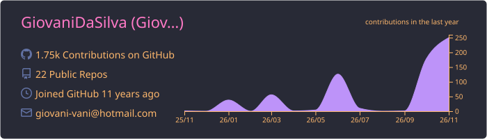
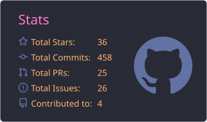
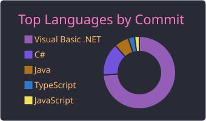
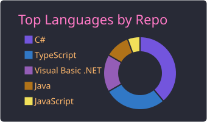
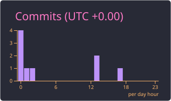

 

---

## 👨‍💻 Sobre mim

Atuo no desenvolvimento de sistemas há mais de **12 anos**. Sou graduado em **Análise e Desenvolvimento de Sistemas** e pós-graduado em **Engenharia de Software para Métodos Ágeis**. Atualmente, trabalho como **Coordenador de Sistemas Sênior**, unindo liderança técnica e mão na massa em projetos próprios.

---

## 🚀 Projetos em Destaque

<table>
  <tr>
    <td width="33%" valign="top">
      <h3>🗣️ <a href="https://talkinho.com.br/">Talkinho</a></h3>
      
Plataforma de conversação com IA para estudar inglês: modos de conversa, gramática, leitura, tradução, descrição de imagem e mais.

    </td>
    <td width="33%" valign="top">
      <h3>🏋️ <a href="https://gdsgym.com.br">GDSGYM</a></h3>
      
Geração personalizada de treinos de musculação, com variedade, divisão por subtreinos e acompanhamento de histórico.

    </td>
    <td width="33%" valign="top">
      <h3>🎵 <a href="https://uplyric.com.br">UpLyric</a></h3>
      
Estudo de inglês através de músicas, com letras sincronizadas, traduções integradas e vocabulário personalizado.

    </td>
  </tr>
</table>

---

## 🛠️ Stack

---

## 📈 Estatísticas

  

<!-- Gerados pelo GitHub Actions (workflow profile-summary.yml): não dependem de servidor externo -->

<table>
  <tr>
    <td valign="top"></td>
    <td valign="top"></td>
  </tr>
  <tr>
    <td valign="top"></td>
    <td valign="top"></td>
  </tr>
</table>

---

⭐ Curtiu algum projeto? Deixe uma estrela e fique à vontade para entrar em contato!

